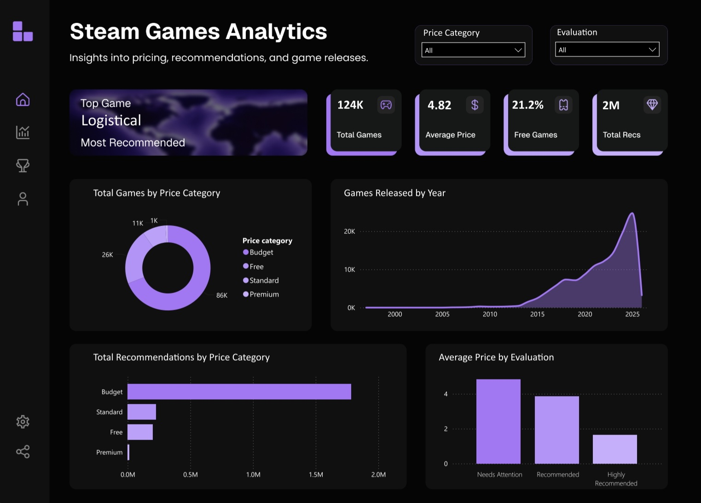

# Steam Games Analytics: Pricing, Releases & User Recommendations

Exploring how pricing tiers, release trends, and player evaluations shape the Steam gaming market, using Microsoft Excel, DAX, and an interactive Power BI dashboard.



## Data source

Processed Steam platform catalog data covering 124K+ game titles, pricing, release years, and user recommendation counts. Raw dataset files are not included in this repository due to file size.

## Overview

This project analyzes over 124,000 games on the Steam platform to understand market dynamics, pricing structures, and community engagement. It asks three core questions:

1. How are games distributed across pricing tiers (Free, Budget, Standard, and Premium)?
2. How have annual game releases evolved over time?
3. Which pricing tiers and evaluation levels drive the highest user recommendations?

## Key findings

* **Market & Pricing Dominance:** Out of 124K+ analyzed games (average price **\$4.82**; **21.2%** free-to-play), the **Budget** tier dominates the catalog with **86K games** and drives the vast majority of total recommendations, followed by Free (26K), Standard (11K), and Premium (1K).
* **Exponential Release Growth:** Annual game releases remained low until 2014, after which the platform experienced exponential growth peaking around **2024–2025**.
* **Community Engagement:** Over **2M total recommendations** were analyzed, with *Logistical* standing out as the top recommended title.
* **Price vs. Evaluation:** Games rated as *Highly Recommended* tend to have a lower average price compared to games categorized as *Needs Attention*.

## Repository structure

```text
├── Steam Games Analytics.pbix   Power BI interactive dashboard (open in Power BI Desktop)
├── Steam Games Analytics.pdf    Static visual report export
├── dashboard.jpg                Dashboard preview image
└── README.md
```

## Methods in brief

* **Data Cleaning & Preparation (Excel):** Handling missing values, standardizing release dates, formatting numeric fields, and validating catalog records.
* **Data Modeling & Custom DAX Measures (Power BI):**
  * **Price Categorization:** Grouping games into *Free*, *Budget*, *Standard*, and *Premium* tiers.
  * **Evaluation Metrics:** Classifying titles based on user ratings into *Needs Attention*, *Recommended*, and *Highly Recommended*.
  * **Core KPIs:** Total Games (124K), Average Price (\$4.82), Free Games Ratio (21.2%), and Total Recommendations (2M+).
* **Interactive Visualization:** Designing a dark-mode analytical dashboard with cross-filtering by Price Category and Evaluation tier.

## How to reproduce

1. Download `Steam Games Analytics.pbix` from this repository.
2. Open the file in **Power BI Desktop** (Windows) to explore the interactive visuals, data model, and DAX formulas.
3. Alternatively, view `Steam Games Analytics.pdf` for a static export of the full report.

## Dashboard

Built in Power BI. It includes KPI cards (Top Recommended Game, Total Games, Average Price, Free Games %, Total Recommendations), a donut chart of games by price category, a yearly release trend line chart, total recommendations by price category, and average price by evaluation level, with interactive slicers for price category and evaluation.

## Limitations

Aggregated platform-level snapshot without individual user playtime logs, regional pricing variations, or post-release discount histories.

## Author

**Nahlah Mohammed**  
[Portfolio](https://nahlahmohammed.framer.website/) | [GitHub](https://github.com/Nahlah-CS)

## License

MIT License. See [LICENSE](LICENSE).
